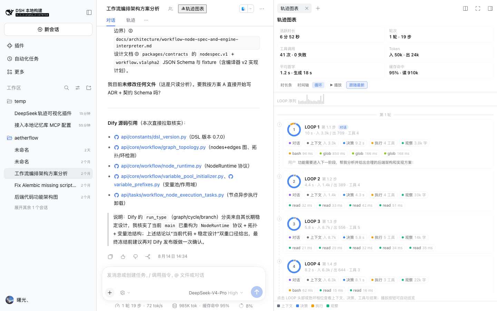
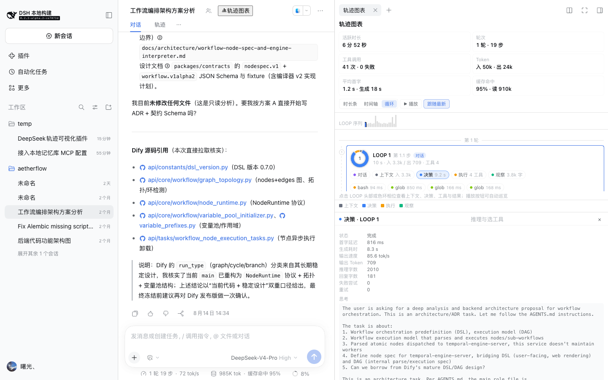
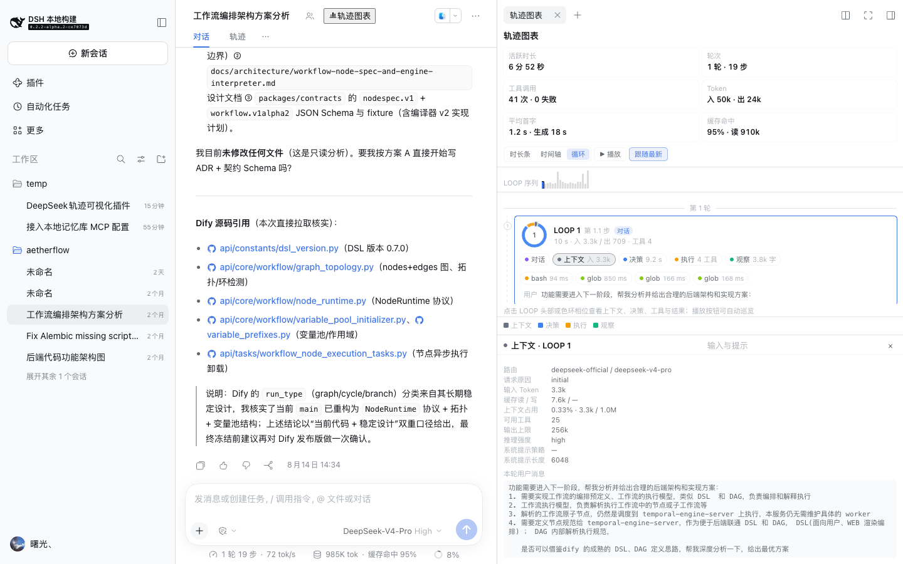
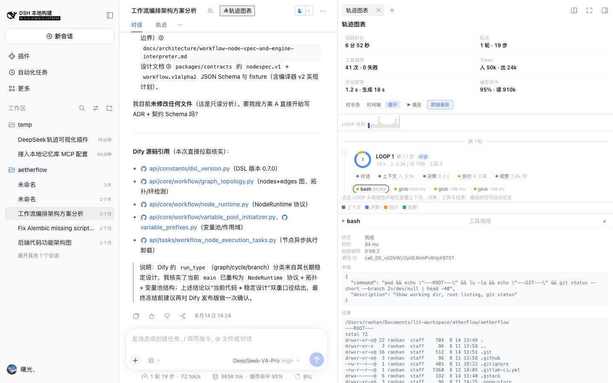
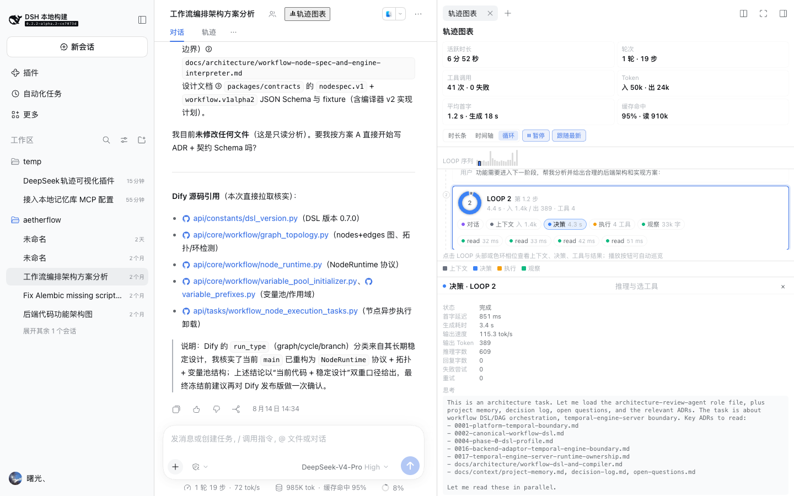
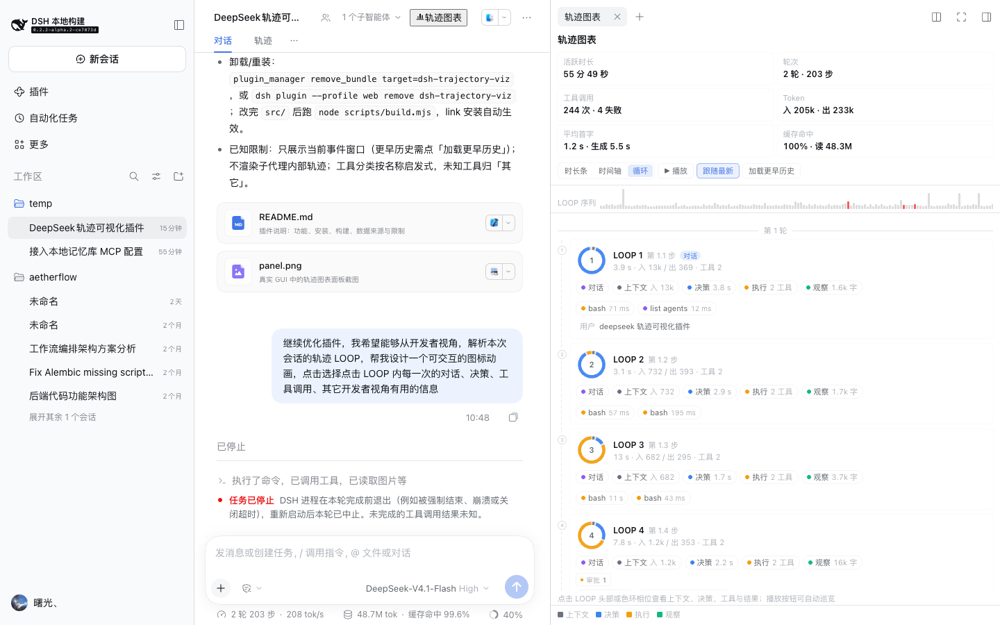
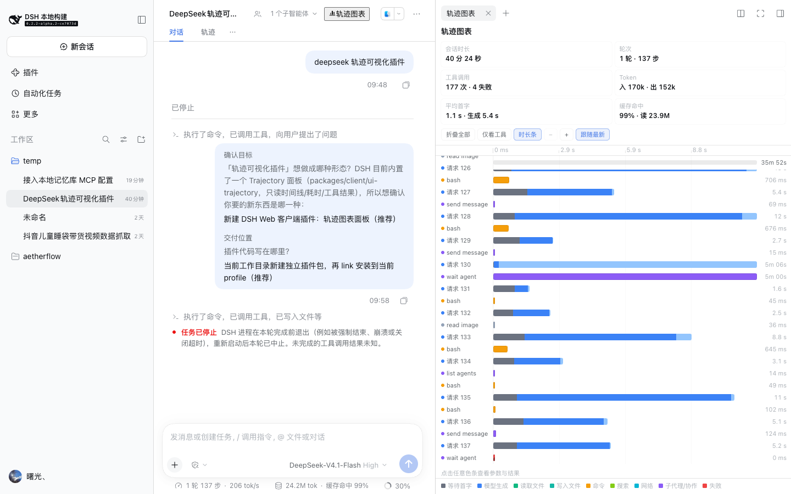
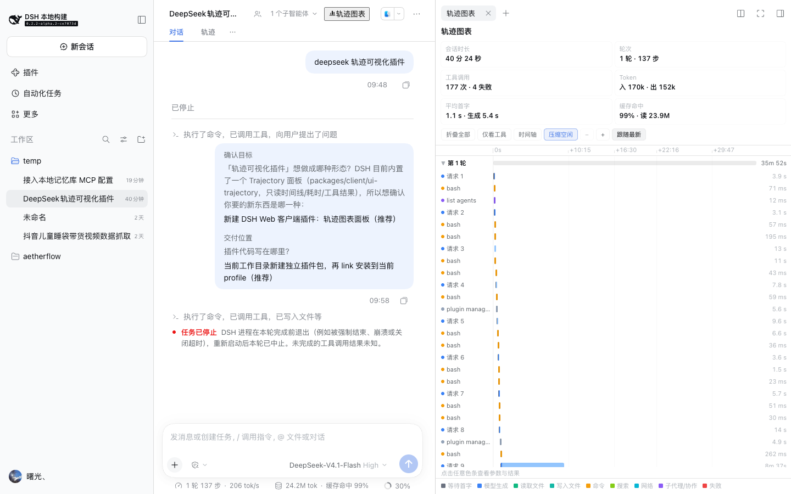
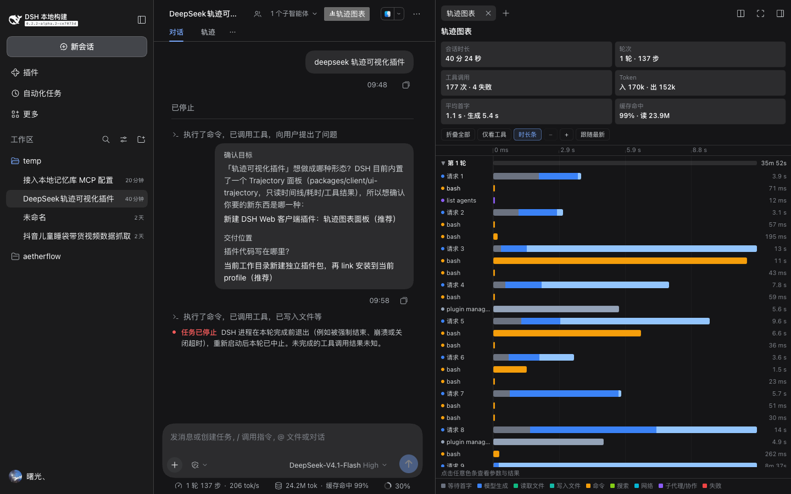

# LOOPScope · `dsh-loopscope`

[](https://github.com/hanranCode/dsh-loopscope/releases)
[](https://github.com/hanranCode/dsh-loopscope/actions/workflows/ci.yml)
[](LICENSE)
[](https://github.com/deepseek-ai/deepseek-harness)
[](package.json)
[](https://github.com/hanranCode/dsh-loopscope/stargazers)

[中文（默认）](README.md) | [English](README.en.md)

**Turn a DeepSeek Harness (DSH) session into interactive charts.** In the DSH web
sidebar, LOOPScope shows — per agent-loop iteration — **what the model saw, what it
decided, which tools it called, and how those tools turned out**, with a LOOP card
view, a duration waterfall, a token ledger and tool-call inspection.

> Keywords: DeepSeek Harness · DSH plugin · agent loop visualization ·
> agent trajectory · LLM trajectory · agent observability · tool call waterfall ·
> token usage · trajectory viewer · prompt inspection



## Table of contents

- [Why](#why)
- [Screenshots](#screenshots)
- [Features](#features)
- [Quick start](#quick-start)
- [The three views](#the-three-views)
- [LOOP view in depth](#loop-view-in-depth)
- [Data sources and privacy](#data-sources-and-privacy)
- [Compatibility](#compatibility)
- [Themes, languages and performance](#themes-languages-and-performance)
- [FAQ and troubleshooting](#faq-and-troubleshooting)
- [Development, testing and releases](#development-testing-and-releases)
- [Security](#security)
- [Contributing](#contributing)
- [License and acknowledgements](#license-and-acknowledgements)

## Why

DSH's built-in Trajectory tab is great for reading **one event at a time**. When a
session grows to 100+ loops and 300+ tool calls, the developer questions change:
which loop was slowest, what was the time-to-first-token, what context and tool
roster did the model get, did this tool call retry, and what is the cache hit
rate? Those questions need **aggregation over time**, not another event list.

LOOPScope reads the session's durable event window (read-only) and lays it out in
three complementary views. It changes nothing, reports nothing, and adds no Host
capability.

## Screenshots

| LOOP view (loop cards + phase ring) | Decision inspector (TTFT / generation / tokens / reasoning) |
|---|---|
|  |  |

| Context inspector (what the model was given) | Tool inspector (arguments / result) |
|---|---|
|  |  |

| Playback (auto-highlights the next loop) | Developer signals (approval / team / deliverable) |
|---|---|
|  |  |

| Duration bars (P90-normalized) | Timeline (real waterfall, idle compressed) |
|---|---|
|  |  |

Dark theme: 

## Features

- **LOOP view**: one card per agent-loop iteration with a clickable four-phase
  ring (context → decision → act → observe), chips for conversation / context /
  decision / act / observe, tool chips and developer-signal badges; a sticky LOOP
  sequence ribbon; and a `▶ Play` walkthrough.
- **Duration bars view**: each row starts at the left edge and is scaled to the
  P90 of settled activity, so long sessions stay readable in a narrow sidebar.
- **Timeline view**: real wall-clock waterfall with idle gaps over 4 s compressed,
  zoom and follow-latest.
- **Summary cards**: active loop time (wall-clock span in the tooltip),
  turns/steps, tool calls and failures, token in/out, average first-token latency
  and generation time, cache hit rate.
- **Developer details**: request route and header reason, context-window usage,
  available tool count, system-prompt length, runtime injections, first-token
  latency, tok/s, reasoning/reply length, failed attempts and retries, tool
  arguments/results/errors.
- **Developer signals**: approval waits, retries, failed attempts, workspace
  changes, presented deliverables, team tasks/members and subagents.
- **Theme and language**: light/dark via the theme's `--dsw-alias-*` tokens; zh/en
  copy follows the GUI language.
- **No runtime dependencies**: the browser artifact requires only React platform
  modules — no Host RPC and no network requests.

## Quick start

### Requirements

- DeepSeek Harness `>=0.2.0 <0.3.0` with the web GUI.
- Installing the plugin needs only DSH; building from source needs Node.js ≥ 20.

### Install

**Option A — plugin manager (recommended)**

Ask a DSH agent to call `plugin_manager` with `install_bundle` and one of:

```
dsh-loopscope                      # once published to npm
github:hanranCode/dsh-loopscope    # straight from GitHub (lib/ is committed, no build needed)
/absolute/path/to/dsh-loopscope    # or a local checkout (link:)
```

**Option B — CLI**

```sh
dsh plugin --profile web add github:hanranCode/dsh-loopscope
dsh --profile web
```

From a local checkout:

```sh
git clone https://github.com/hanranCode/dsh-loopscope.git
dsh plugin --profile web add /absolute/path/to/dsh-loopscope
```

Remove:

```sh
dsh plugin --profile web remove dsh-loopscope
```

### Open it

1. Open any session.
2. Click **“轨迹图表” (Trajectory chart)** in the session header (or open it from
   the right-sidebar guide / the tab “+” control).
3. Switch between **Duration bars / Timeline / Loop** in the toolbar.

> If the button does not appear after installation, refresh the page once so the
> client fetches the new bundle.

## The three views

| View | Question it answers | Use it for |
|---|---|---|
| **Duration bars** (default) | How long did each step and tool call take? Which was slowest? | Scanning long sessions, finding hot spots |
| **Timeline** | What ran serial or parallel, and where is the waiting? | First-token latency, approvals, long-running tools |
| **LOOP** | What did this iteration see, decide and do? | Debugging agent behaviour, inspecting context and tool selection |

### Duration bars

Each row starts at the left edge; its length is the activity's duration over the
P90 of settled activities. Failed tools use a red hatch, running activities pulse,
and the duration column stays right-aligned. P90 instead of the maximum keeps one
10-minute approval from flattening every other bar into a hairline.

### Timeline

Real time axis; idle gaps over 4 s are compressed (the “Compress idle” toggle
turns that off). `−`/`+` zoom, “Follow latest” scrolls to the newest activity.
Axis labels carry a `+` prefix to mark an offset from the session start.

### Loop

See the next section.

## LOOP view in depth


One LOOP is one model request plus the tool executions it triggered (a DSH step).
Card anatomy:

- **Phase ring**: `Context` (grey) → `Decision` (blue) → `Act` (orange) →
  `Observe` (green); arc length follows phase duration. Click an arc or chip to
  select the phase; the selected arc thickens. A running loop gets a spinning
  sweep ring and a pulsing node.
- **Card header**: `LOOP n`, step, duration, token in/out, tool count. Click the
  header to inspect the conversation.
- **Phase chips**: Conversation / Context / Decision / Act / Observe, each with a
  key fact (input tokens, decision time, tool count, result characters).
- **Tool chips**: coloured by tool family; click for arguments and result.
- **Signal badges**: approvals, retries, failed attempts, workspace changes,
  deliverables, team tasks/members, subagents.
- **LOOP sequence ribbon** (sticky): one mini bar per loop, height ≈ sqrt of
  duration; running is blue and pulses, loops with failed tools are red, the
  selected loop is highlighted; click to jump.
- **`▶ Play` / `⏸ Pause`**: advances one loop every 1.4 s, scrolls it into view
  and keeps the inspector in sync.

Inspector by phase:

| Phase | Inspector |
|---|---|
| Conversation | User message for the turn, model reasoning, assistant output, status and duration |
| Context | Route, header reason, input tokens, cache read/write, context-window usage, tools available, output cap, reasoning effort, system-prompt mode/length, runtime injections, user message |
| Decision | Status, first-token latency, generation time, tok/s, output tokens, reasoning/reply length, failed attempts, retries, reasoning text, reply text, selected tools |
| Act | Tool count, failures, total tool time, per-tool arguments/results/errors (click through to a single tool) |
| Observe | Result characters, errors, next step (next LOOP / end of turn), per-tool result excerpts |

## Data sources and privacy

The plugin **only reads** the current session's durable event window through the
injected `sessions` service (`eventSource`). It reads no files, makes no network
requests, writes no storage and reports no telemetry. Parsed events:

| Event | Contribution |
|---|---|
| `turn/start` / `turn/end` | Turn boundaries and end reason |
| `step/start` / `step/end` | One LOOP's boundary |
| `user/message` | The turn's prompt |
| `system/message` / `developer/message` | System-prompt length, runtime injections (tool registry updates, …) |
| `request/header` / `request/context` | Dispatch time, route, tool roster, context window, prompt policy |
| `assistant/message` | Settlement time, token usage, compact stream (first token / generation window) |
| `assistant/attempt` / `llm/retry` | Failed attempts and retries |
| `tool/call` / `tool/result` | Tool span, arguments, result, error |
| `job/registered` / `job/settled` | More precise finish time for long tasks |
| `approval/asked` / `approval/decided` | Approval gate wait |
| `workspace/changes` / `deliverables/presented` / `team/task` / `team/member` / `subagent/catalog` | Developer-signal badges |

## Compatibility

| Item | Requirement |
|---|---|
| DSH | `>=0.2.0 <0.3.0` (web GUI; `dsh.client` platform `web`) |
| Browser | Modern Chromium (whatever the DSH web GUI supports) |
| Runtime dependencies | None (React platform modules are provided by DSH) |
| Build | Node.js ≥ 20 (`npm run build`) |
| Languages | Chinese / English (follows the GUI language) |

## Themes, languages and performance

- Colors follow the theme through `--dsw-alias-*` semantic tokens; the chart's
  categorical palette (tool families, loop phases) uses fixed values verified on
  both light and dark bases.
- zh/en copy is registered through `ctx.locale` under the `loopscope` namespace;
  switching languages does not reload the page.
- Views are synchronous O(n) folds over the event window. Sessions with 200+ loops
  render without stutter and the list virtualizes only by scrolling; the panel
  never polls the Host.

## FAQ and troubleshooting

**Q: The “Trajectory chart” button is missing after installation.**
A: Refresh the page first. If it is still missing, check whether
`~/.dsh/profiles/web/package.json` lists `dsh-loopscope` in `dsh.profile.bundles`
and whether the `dsh web` log reports a load error for the bundle.

**Q: The panel says “No trajectory events yet”.**
A: A fresh session has no steps yet; send a message first. The history window
covers only recent events; use “Load earlier history” for more.

**Q: The duration looks huge/small.**
A: The first card is active loop time (sum of LOOP durations); hover it to see the
wall-clock session span. Idle time between turns is excluded.

**Q: Some context fields show `—`.**
A: `request/header` and `request/context` are only recorded when the route,
capacity or prompt policy changes. Known values are carried forward, but facts
missing from the session head stay `—`.

**Q: Many LOOP cards scroll slowly.**
A: The view renders the event window. Use “Load earlier history” to bound it, or
switch to Duration bars / Tools only to narrow down.

**Q: How do I inspect a single tool?**
A: Click its chip in the LOOP view, or open the Act phase inspector and click the
tool row.

## Development, testing and releases

```sh
npm install
npm run build        # writes lib/host.js + lib/client.js (artifacts are committed)
npm run check        # artifact format + parser replay over a real log or the fixture
npm run check:render # server-rendered zh/en panel and LOOP structural checks
npm test             # both checks
```

- Design notes: [DESIGN.md](DESIGN.md)
- Contribution guide: [CONTRIBUTING.md](CONTRIBUTING.md)
- Changelog: [CHANGELOG.md](CHANGELOG.md)

Release flow: update `CHANGELOG.md` and the `package.json` version →
`npm run build && npm test` → commit → `git tag vX.Y.Z` → push → GitHub Release.

## Security

The plugin handles no credentials, makes no network requests and writes no files;
event text is rendered as React text nodes (no `innerHTML`, no `eval`). Report
vulnerabilities through GitHub's private security channel; see
[SECURITY.md](SECURITY.md).

## Contributing

Issues and PRs are welcome — new phase facts, new developer signals, tool
categories, languages, accessibility and performance improvements especially so.
Please read [CONTRIBUTING.md](CONTRIBUTING.md) first (build, bilingual copy,
screenshots and PR checklist).

## License and acknowledgements

- License: [MIT](LICENSE) © 2026 hanranV ([hanranCode](https://github.com/hanranCode))
- Built on the plugin system and `window.__ModuleLoader__` client loader of
  [DeepSeek Harness](https://github.com/deepseek-ai/deepseek-harness). The LOOP
  phase model is inspired by agent loops and OpenTelemetry span semantics.
- The categorical palette, phase rings and sequence ribbon are original work.
