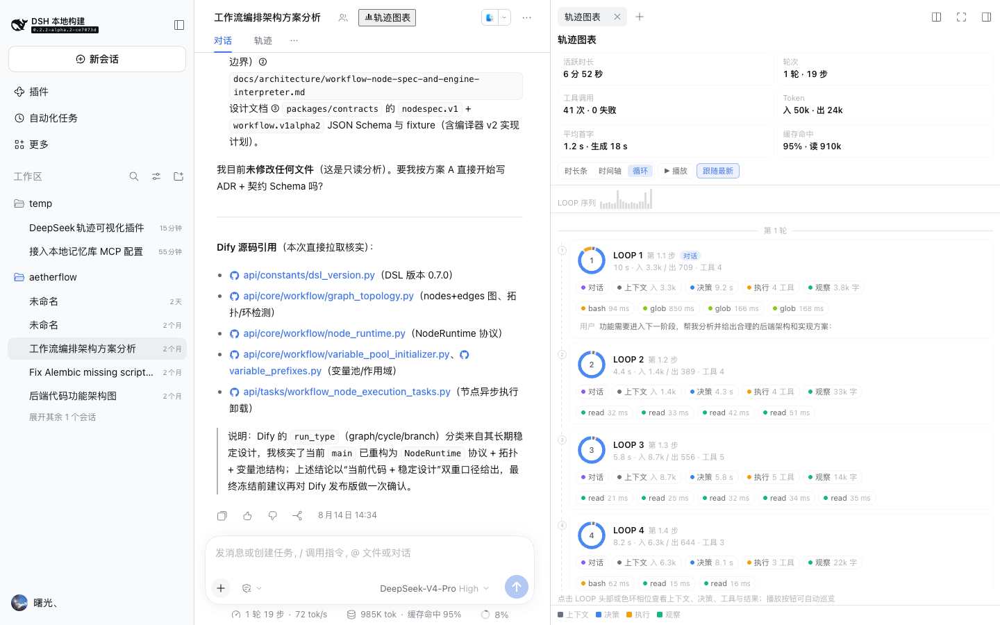
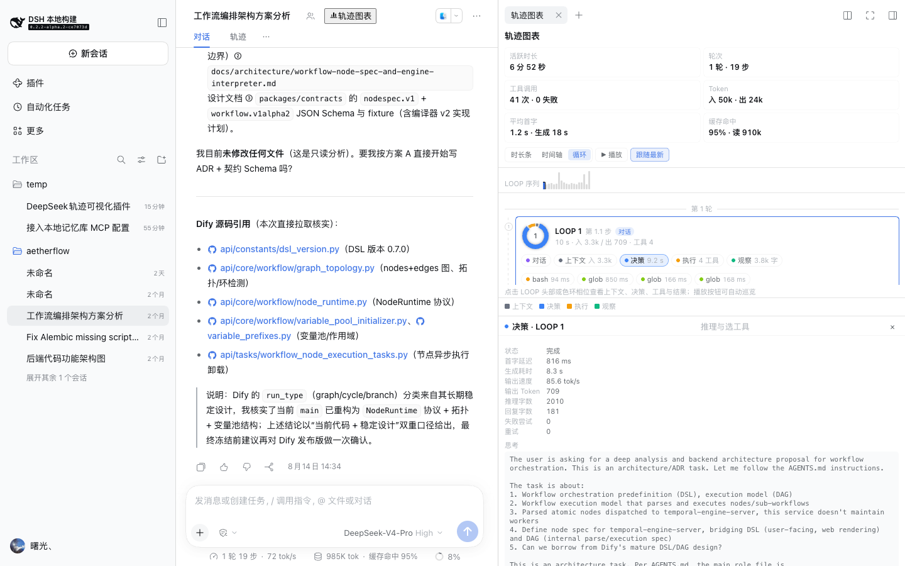
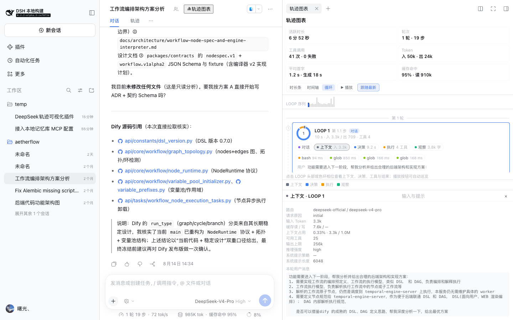
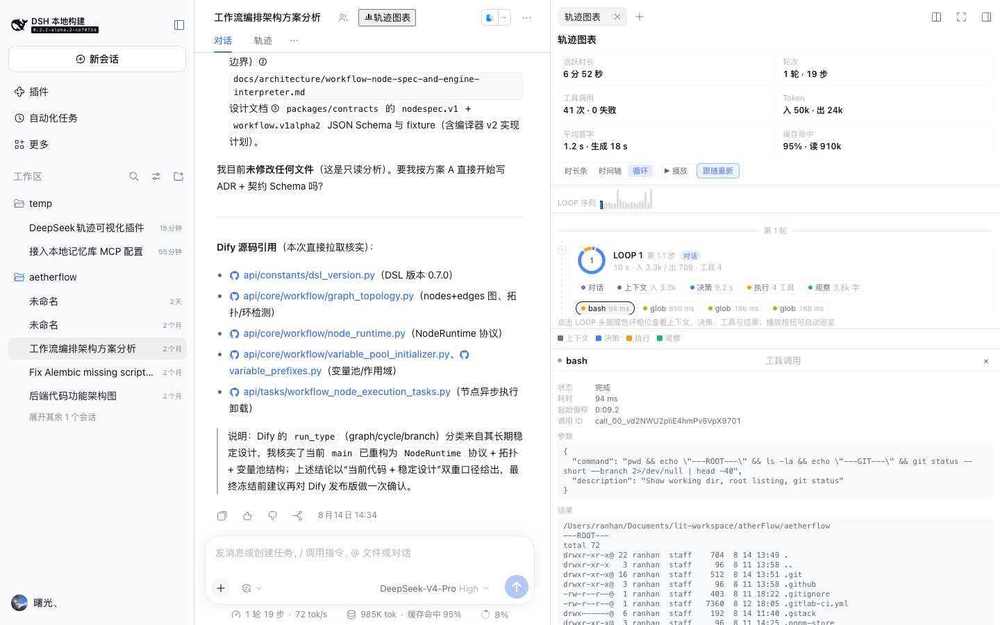
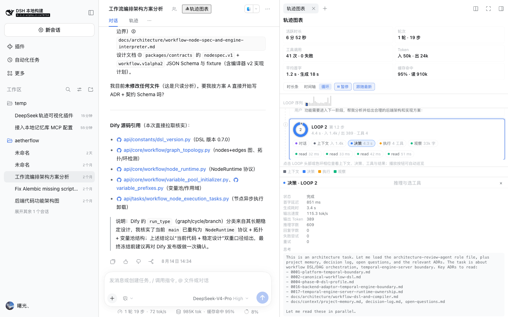
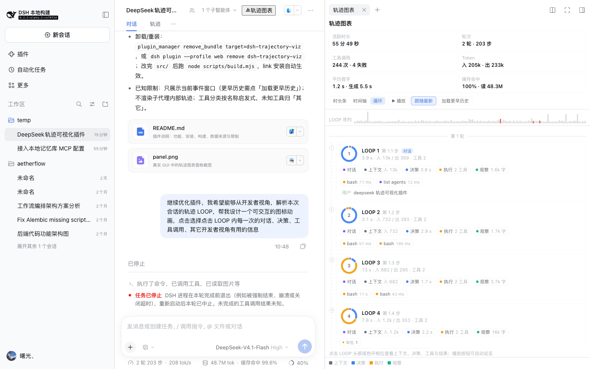
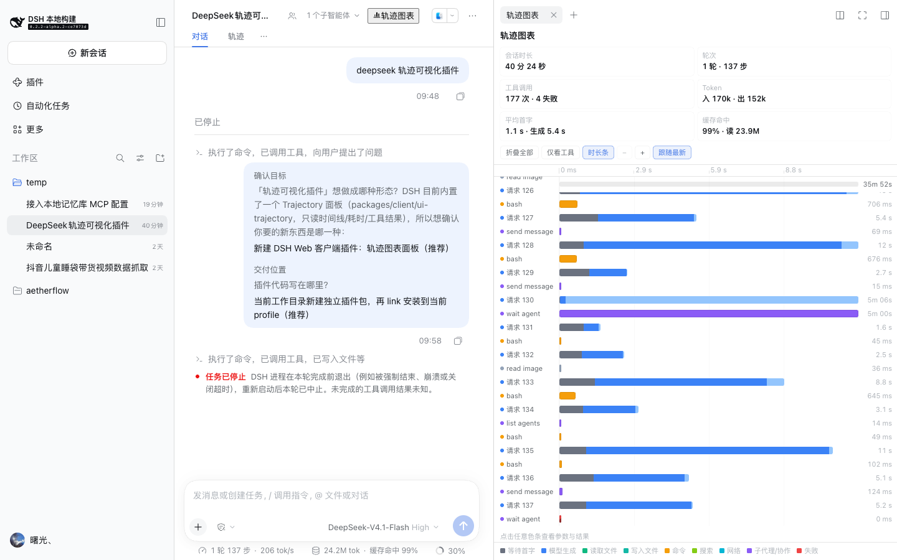
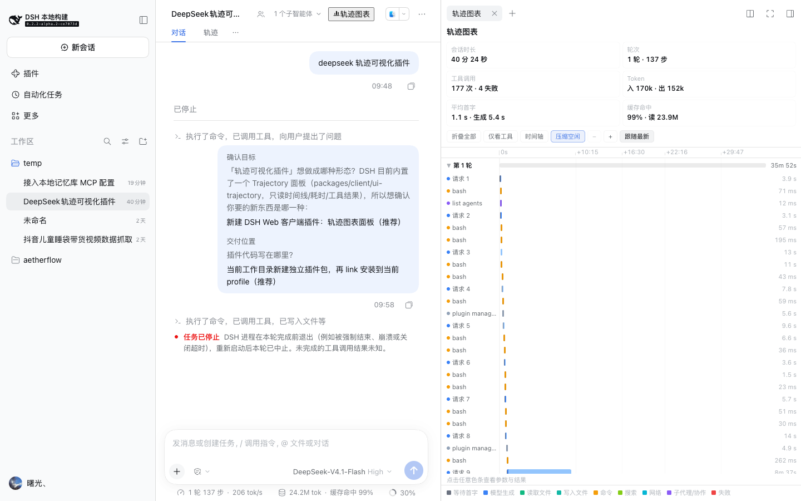
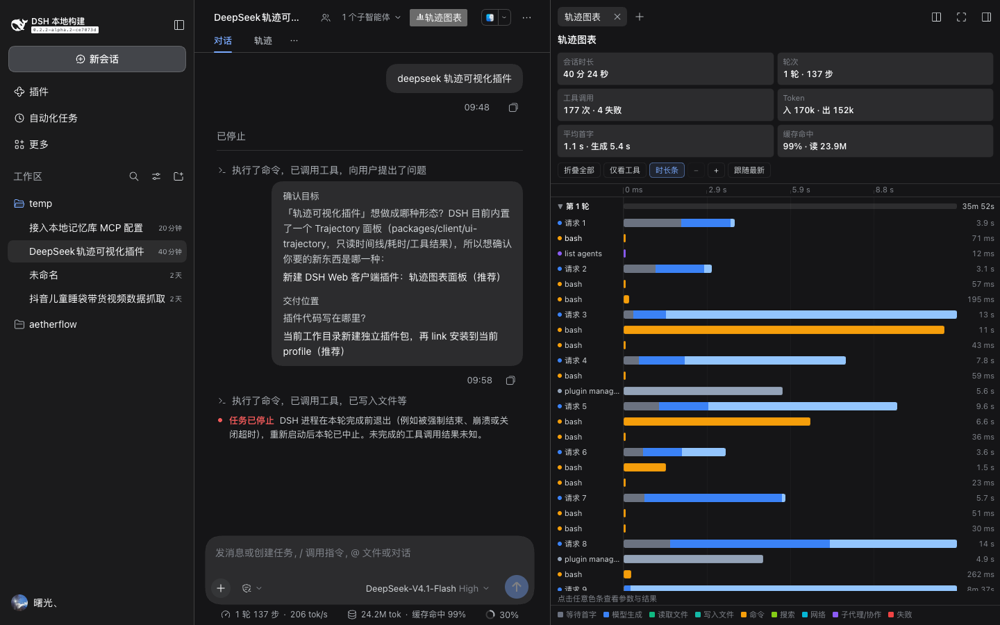

# LOOPScope · `dsh-loopscope`

[](https://github.com/hanranCode/dsh-loopscope/releases)
[](https://github.com/hanranCode/dsh-loopscope/actions/workflows/ci.yml)
[](LICENSE)
[](https://github.com/deepseek-ai/deepseek-harness)
[](package.json)
[](https://github.com/hanranCode/dsh-loopscope/stargazers)

[中文（默认）](README.md) | [English](README.en.md)

**把 DeepSeek Harness（DSH）会话的执行轨迹变成可交互的图表。** 在 Web GUI 右侧栏里，用
「LOOP 循环卡片 + 瀑布耗时 + Token 账本 + 工具调用明细」看清 agent 每一轮循环里
**模型看到了什么、决定了什么、调用了什么、结果如何**。

> 关键词 / Keywords：DeepSeek Harness · DSH plugin · agent loop visualization ·
> agent trajectory · LLM trajectory · agent observability · 工具调用瀑布图 ·
> token usage · trajectory viewer · 轨迹可视化 · 循环视图 · prompt inspection



## 目录

- [为什么需要它](#为什么需要它)
- [效果展示](#效果展示)
- [功能特性](#功能特性)
- [快速开始](#快速开始)
- [三种视图](#三种视图)
- [LOOP 视图详解](#loop-视图详解)
- [数据来源与隐私](#数据来源与隐私)
- [兼容性](#兼容性)
- [主题、语言与性能](#主题语言与性能)
- [常见问题与排障](#常见问题与排障)
- [开发、测试与发布](#开发测试与发布)
- [安全](#安全)
- [贡献](#贡献)
- [许可证与致谢](#许可证与致谢)

## 为什么需要它

DSH 自带的「轨迹」页签擅长**逐条**查看事件；但当一次会话有 100+ 个 LOOP、300+ 次工具调用时，
开发者真正关心的问题变成了：哪一轮最慢？首字延迟是多少？模型这一轮拿到了哪些上下文和工具？
这次工具调用失败是不是重试过？缓存命中率如何？——这些都需要**聚合与时间维度**的视图。

LOOPScope 只读地消费会话的 durable event window，把这些信息整理成三种互补的视图，
不改动、不上报、不新增任何 Host 能力。

## 效果展示

| LOOP 视图（循环卡片 + 相位环） | 决策明细（首字延迟 / 生成 / Token / 推理） |
|---|---|
|  |  |

| 上下文明细（模型给到了什么） | 工具调用明细（参数 / 结果） |
|---|---|
|  |  |

| 播放巡览（自动高亮下一个 LOOP） | 开发信号徽标（审批 / 团队 / 产物） |
|---|---|
|  |  |

| 时长条视图（P90 归一化） | 时间轴视图（真实瀑布 + 压缩空闲） |
|---|---|
|  |  |

深色主题：

## 功能特性

- **LOOP 循环视图**：每个 agent 循环一张卡片，四段相位环（上下文 → 决策 → 执行 → 观察）可点击；
  卡片内含对话 / 上下文 / 决策 / 执行 / 观察 chips、工具 chip、开发信号徽标；顶部 LOOP 序列
  ribbon 可点击跳转；`▶ 播放` 自动巡览。
- **时长条视图**：每行从左侧起、长度按窗口内 P90 耗时归一，长会话在窄侧栏也清晰。
- **时间轴视图**：真实时间瀑布，超过 4 秒的空闲自动压缩，支持缩放与跟随最新。
- **汇总卡**：活跃时长（悬停显示含空闲的会话跨度）、轮次/步数、工具调用与失败数、Token 入/出、
  平均首字延迟与生成耗时、缓存命中率。
- **开发者明细**：请求路由与请求原因、上下文窗口占用、可用工具数、系统提示长度、运行中注入、
  首字延迟、tok/s、推理/回复字数、失败尝试与重试、工具参数与结果、错误码。
- **开发信号**：审批等待、重试、失败尝试、工作区变更、产物展示、团队任务/成员、子代理。
- **多语言与主题**：中/英自动跟随 GUI 语言；明暗主题跟随 `--dsw-alias-*` 语义变量。
- **零依赖运行时**：浏览器产物只 `require` React 平台模块；无 Host RPC、无网络请求。

## 快速开始

### 环境要求

- DeepSeek Harness `>=0.2.0 <0.3.0`（Web GUI）。
- 安装插件时只需要 DSH；从源码构建需要 Node.js ≥ 20。

### 安装

**方式 A：插件管理器（推荐）**

让 DSH agent 调用 `plugin_manager` 的 `install_bundle`，`target` 传下列之一：

```
dsh-loopscope                      # npm 发布后
github:hanranCode/dsh-loopscope    # 或直接从 GitHub 安装（lib/ 已提交，无需构建）
/absolute/path/to/dsh-loopscope    # 或从本地 checkout 安装（link:）
```

**方式 B：CLI**

```sh
dsh plugin --profile web add github:hanranCode/dsh-loopscope
dsh --profile web
```

从本地 checkout 安装：

```sh
git clone https://github.com/hanranCode/dsh-loopscope.git
dsh plugin --profile web add /absolute/path/to/dsh-loopscope
```

卸载：

```sh
dsh plugin --profile web remove dsh-loopscope
```

### 打开

1. 打开任意会话。
2. 点击会话标题栏右侧的 **「轨迹图表」** 按钮（也可从右侧栏引导页 / 页签「+」打开）。
3. 在工具栏切换 **时长条 / 时间轴 / 循环**。

> 安装后若按钮未出现，刷新一次页面（客户端 bundle 需要重新拉取）。

## 三种视图

| 视图 | 回答的问题 | 适合场景 |
|---|---|---|
| **时长条**（默认） | 每一步、每次工具调用花了多久？谁最慢？ | 快速扫描长会话、找性能热点 |
| **时间轴** | 串行/并行关系、等待与空闲在哪？ | 定位首字延迟、审批等待、长任务 |
| **循环** | 这一轮模型看到了什么、决定了什么、做了什么？ | 调试 agent 行为、检查上下文与工具选择 |

### 时长条

每行从左边缘起，长度 = 该活动耗时 / 窗口内已完成活动的 P90 耗时。失败工具为红色斜纹，
运行中的活动脉冲显示；右侧固定耗时列。用 P90 而非最大值，避免一次 10 分钟的审批把其余色条压成细线。

### 时间轴

真实时间轴；相邻活动间超过 4 秒的空闲会被压缩（可关闭「压缩空闲」）。`−`/`+` 缩放，
「跟随最新」自动滚动到最新活动。轴线标签带 `+` 前缀表示相对会话开始的偏移。

### 循环（LOOP）

见下一节。

## LOOP 视图详解


每个 LOOP = 一次模型请求 + 它触发的工具执行（DSH 的 step）。卡片元素：

- **相位环**：`上下文`（灰）→ `决策`（蓝）→ `执行`（橙）→ `观察`（绿）四段弧，弧长按相位耗时；
  点击弧段选中该相位，选中弧加粗；运行中的 LOOP 环上有旋转扫描弧、节点脉冲。
- **卡片头**：`LOOP n`、`第 turn.step 步`、时长、Token 入/出、工具数；点击卡片头查看「对话」。
- **phase chips**：对话 / 上下文 / 决策 / 执行 / 观察，各带事实值（输入 token、决策耗时、工具数、结果字数）。
- **工具 chips**：按工具族着色，点击查看参数与结果。
- **开发信号徽标**：审批、重试、失败尝试、工作区变更、产物、团队任务/成员、子代理。
- **LOOP 序列 ribbon**（sticky）：每个 LOOP 一根迷你柱，高度按耗时平方根归一；运行中蓝色脉冲、
  含失败工具红色、当前选中高亮；点击跳转。
- **`▶ 播放` / `⏸ 暂停`**：每 1.4 秒自动前进一个 LOOP，滚动到可见并同步明细。

点击相位后的明细内容：

| 相位 | 明细 |
|---|---|
| 对话 | 本轮用户消息、模型思考、助手输出、状态与时长 |
| 上下文 | 路由、请求原因、输入 Token、缓存读/写、上下文窗口占用、可用工具、输出上限、推理强度、系统提示策略/长度、运行中注入、本轮用户消息 |
| 决策 | 状态、首字延迟、生成耗时、输出速度（tok/s）、输出 Token、推理/回复字数、失败尝试、重试、推理正文、回复文本、模型选择的工具 |
| 执行 | 工具数、失败数、工具总耗时、每个工具的参数/结果/错误（可继续点击进入单工具明细） |
| 观察 | 结果字符数、错误数、下一步（进入下一 LOOP / 本轮结束）、每个工具的结果回填摘要 |

## 数据来源与隐私

插件**只读**当前会话的 durable event window（通过注入的 `sessions` 服务的 `eventSource`），
不读取文件、不发网络请求、不写存储、不上报数据。解析的事件：

| 事件 | 用途 |
|---|---|
| `turn/start` / `turn/end` | 轮次边界与结束原因 |
| `step/start` / `step/end` | 一个 LOOP 的边界 |
| `user/message` | 本轮用户提示 |
| `system/message` / `developer/message` | 系统提示长度、运行中注入（工具注册更新等） |
| `request/header` / `request/context` | 请求时刻、路由、工具清单、上下文窗口、系统提示策略 |
| `assistant/message` | 结算时刻、token 用量、紧凑流（首字/生成窗口） |
| `assistant/attempt` / `llm/retry` | 失败尝试与重试 |
| `tool/call` / `tool/result` | 工具耗时、参数、结果、错误 |
| `job/registered` / `job/settled` | 长任务更精确的结束时间 |
| `approval/asked` / `approval/decided` | 审批等待 |
| `workspace/changes` / `deliverables/presented` / `team/task` / `team/member` / `subagent/catalog` | 开发信号徽标 |

## 兼容性

| 项 | 要求 |
|---|---|
| DSH | `>=0.2.0 <0.3.0`（Web GUI；`dsh.client` 平台 `web`） |
| 浏览器 | 现代 Chromium（DSH Web GUI 支持的版本） |
| 运行时依赖 | 无（仅 React 平台模块，由 DSH 提供） |
| 构建 | Node.js ≥ 20（`npm run build`） |
| 语言 | 中文 / English（跟随 GUI 语言） |

## 主题、语言与性能

- 颜色通过 `--dsw-alias-*` 语义变量跟随主题；图表分类色（工具族、LOOP 相位）使用固定色值并在
  明暗两种背景下验证可读。
- 中英文案通过 `ctx.locale` 注册（`loopscope` 命名空间），切换语言无需刷新。
- 视图按事件窗口计算，全部为同步、O(n) 折叠；长会话（200+ LOOP）渲染无卡顿，列表滚动即渲染；
  面板不自动轮询 Host。

## 常见问题与排障

**Q：安装后标题栏没有「轨迹图表」按钮？**
A：先刷新页面；若仍没有，检查 `~/.dsh/profiles/web/package.json` 的 `dsh.profile.bundles` 是否包含
`dsh-loopscope`，并查看 `dsh web` 启动日志是否有该包加载错误。

**Q：面板显示「暂无轨迹事件」？**
A：新会话或尚未产生 step 的会话没有轨迹；发一条消息后再看。历史窗口只覆盖最近一段事件，
点击「加载更早历史」。

**Q：会话时长显示很大/很小？**
A：首卡是「活跃时长」（所有 LOOP 时长之和），悬停可见含空闲的会话跨度。跨天空闲不会计入活跃时长。

**Q：`上下文` 里某些字段是 `—`？**
A：`request/header` 与 `request/context` 只在路由/容量/提示策略变化时记录；插件会把最近一次已知值
带到后续 LOOP，但会话头部缺失的字段仍显示 `—`。

**Q：LOOP 卡片很多时滚动卡顿？**
A：视图按事件窗口渲染；可先「加载更早历史」控制窗口，或用「仅看工具 / 时长条」视图定位。

**Q：如何只查看某个工具的问题？**
A：在 LOOP 视图点击该工具 chip，或在「执行」相位明细里继续点击工具进入单工具参数/结果页。

## 开发、测试与发布

```sh
npm install
npm run build        # 生成 lib/host.js + lib/client.js（仓库已提交产物）
npm run check        # 产物格式 + 真实会话/样例 fixture 的解析断言
npm run check:render # 服务端渲染中英文面板与 LOOP 视图的结构断言
npm test             # 上述两项
```

- 设计说明：[DESIGN.md](DESIGN.md)
- 贡献指南：[CONTRIBUTING.md](CONTRIBUTING.md)
- 变更记录：[CHANGELOG.md](CHANGELOG.md)

发布流程：更新 `CHANGELOG.md` 与 `package.json` 版本 → `npm run build && npm test` →
提交 → `git tag vX.Y.Z` → push → GitHub Release。

## 安全

插件不接触凭据、不发网络请求、不写文件；事件文本以 React 文本节点渲染（无 `innerHTML`/`eval`）。
漏洞报告请使用 GitHub Security 私密通道，详见 [SECURITY.md](SECURITY.md)。

## 贡献

欢迎 issue / PR：新相位指标、新开发信号、新工具分类、新语言、可访问性与性能改进尤其欢迎。
请先阅读 [CONTRIBUTING.md](CONTRIBUTING.md)（构建、双语、截图与提交检查清单）。

## 许可证与致谢

- License：[MIT](LICENSE) © 2026 hanranV（[hanranCode](https://github.com/hanranCode)）
- 构建离不开 [DeepSeek Harness](https://github.com/deepseek-ai/deepseek-harness) 的插件体系与
  `window.__ModuleLoader__` 客户端加载器；LOOP 视图的相位概念受 agent loop 与 OpenTelemetry
  的 span 语义启发。
- 分类色板、相位环与 ribbon 为原创实现。
